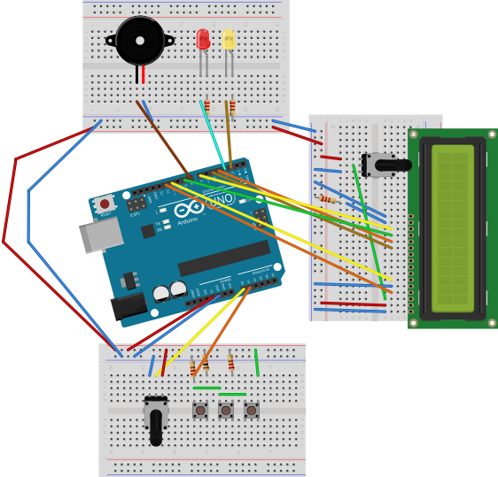

# Arduino Metronome

A simple metronome built with Arduino Uno, featuring LCD display, adjustable BPM, sound, and visual beat indicators.

## Features

- BPM range: 40-240 (controlled via potentiometer)
- Visual beat indicator with 2 LEDs
- Audio click (toggle on/off)
- Configurable beat count (1-8)
- 16x2 LCD display with custom icons

## Hardware Components

- Arduino Uno (Rev3)
- 16x2 LCD Display (LiquidCrystal library)
- 2x LEDs (red, yellow)
- Piezo speaker
- 10kΩ Potentiometer
- 3x Pushbuttons
- 220Ω Resistors (for LEDs)

## Pin Configuration

| Pin | Component |
|-----|-----------|
| A0 | Potentiometer (BPM control) |
| A1 | Button inputs |
| 2 | Red LED (beat indicator) |
| 3 | Yellow LED (subdivision) |
| 4-7, 9, 11, 12 | LCD display |
| 8 | Piezo speaker |

## Controls

| Button | Function |
|--------|----------|
| 1 | Start/Stop metronome |
| 2 | Toggle sound |
| 3 | Cycle beat count (1-8) |

## Usage

1. Open `metronom.ino` in Arduino IDE
2. Upload to Arduino Uno
3. Adjust BPM with the potentiometer
4. Use buttons to control features

## Recent Updates

### Bug Fixes & Robustness (April 2026)
- Fixed buzzer pin not set as OUTPUT before tone()
- Added INPUT_PULLUP for stable button readings
- Implemented 200ms button debouncing
- Refactored button detection with range-based thresholds
- Replaced magic numbers with named constants
- Removed unused code